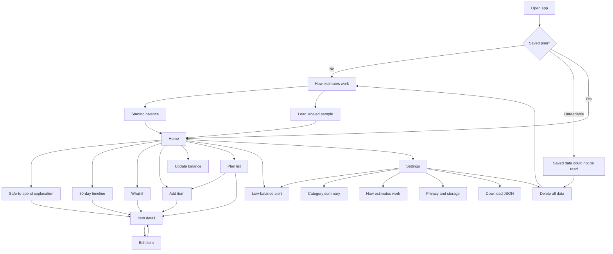

# Sitemap

MoneyMind is one plan in one browser. There is no account switcher and no marketing site inside the prototype.

## Navigation

**Phone, under 880px:** Home, Timeline, What-if, and Plan are in the bottom bar. Settings is in the header. Explanation, alerts, summary, and balance update are reached from Home or Settings.

**880px and wider:** The same destinations sit in a left column, including Settings. The header Settings link hides so it is not duplicated.

**Onboarding, balance edit, the explainer replay, privacy, and the unreadable-data screen** do not show the app bar. Each of those screens has a text path back.

## Labels used in navigation

| Label | Route | Why this word |
| --- | --- | --- |
| Home | `#/home` | The decision screen, not a dashboard of charts. |
| Timeline | `#/timeline` | The 30-day ledger. “Forecast” is easy to hear as a promise. |
| What-if | `#/what-if` | Matches the PRD scenario and states uncertainty. |
| Plan | `#/plan` | The items the person entered. Not “transactions,” because nothing has posted. |
| Settings | `#/settings` | Balance, alert, export, delete, privacy. |

## Global chrome

- Wordmark returns Home, or the explainer if there is no plan.
- Pill: “Estimate.”
- Pill: “Sample” when the plan is sample data.
- Pill: “On this device,” or “Offline” when the browser reports offline.

## Not in the sitemap

Bank linking, goals, household members, advice, investments, and a separate login. Adding them would be a scope change, not a missing link.
