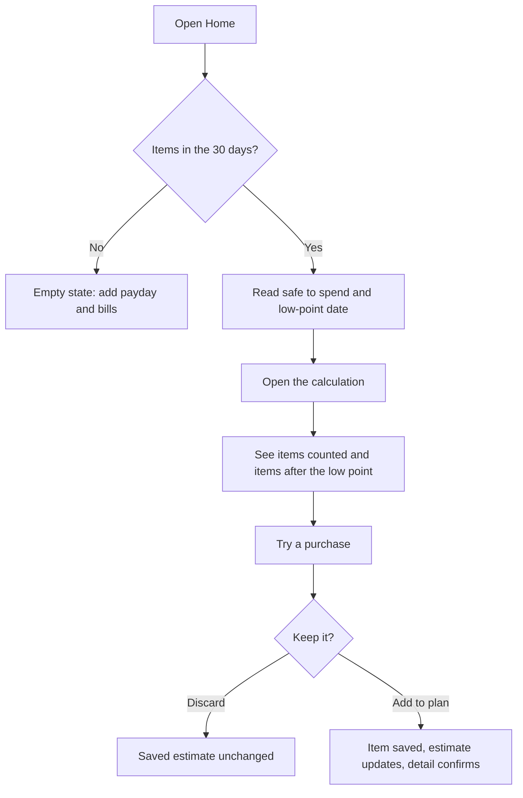
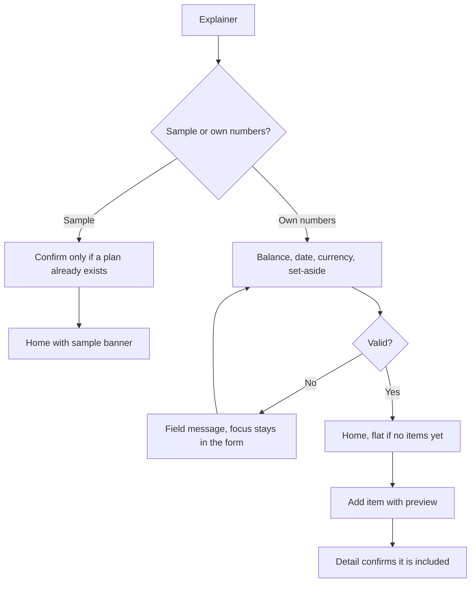
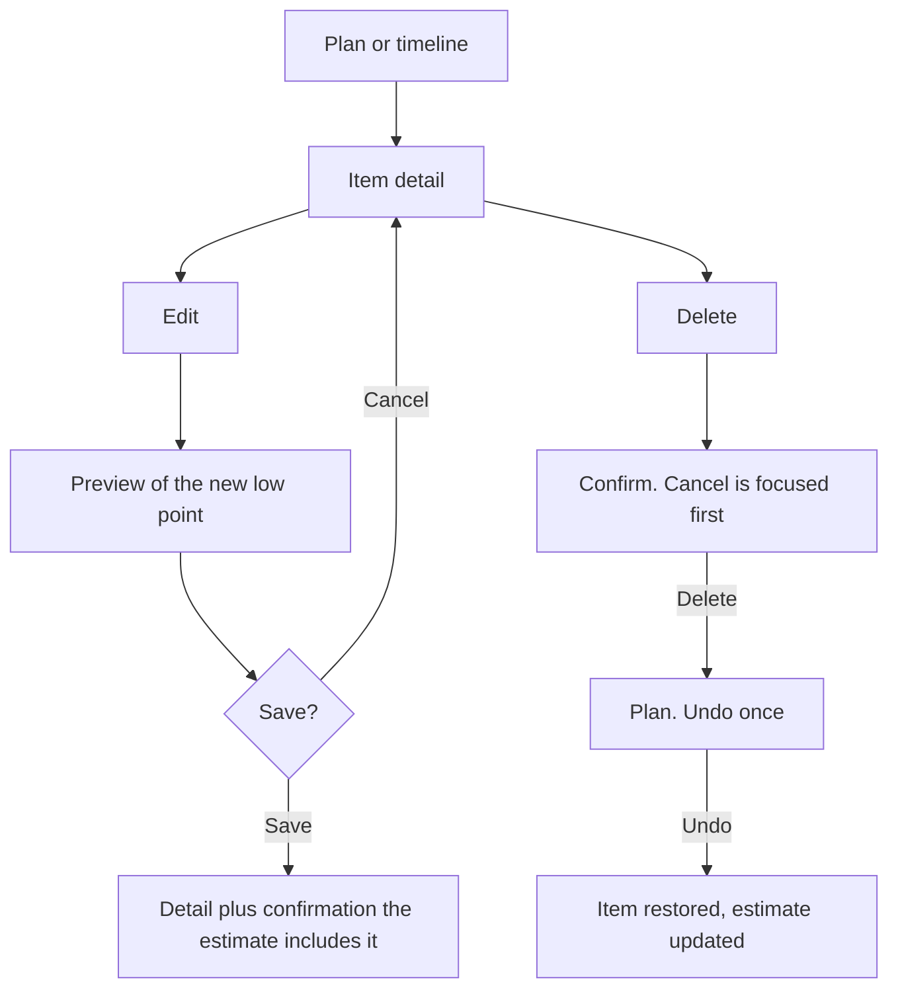
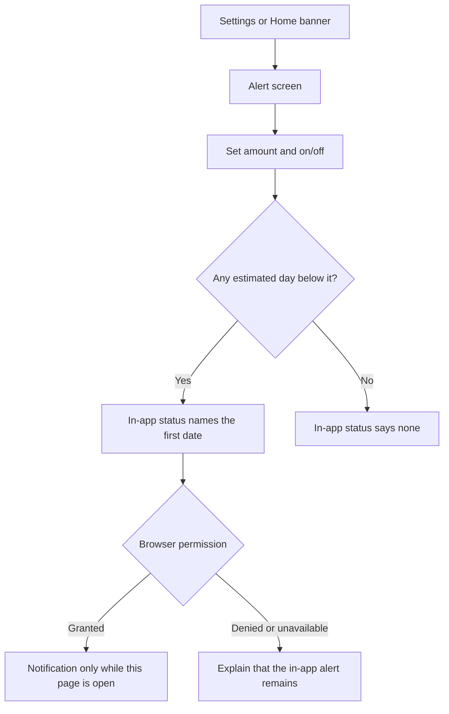
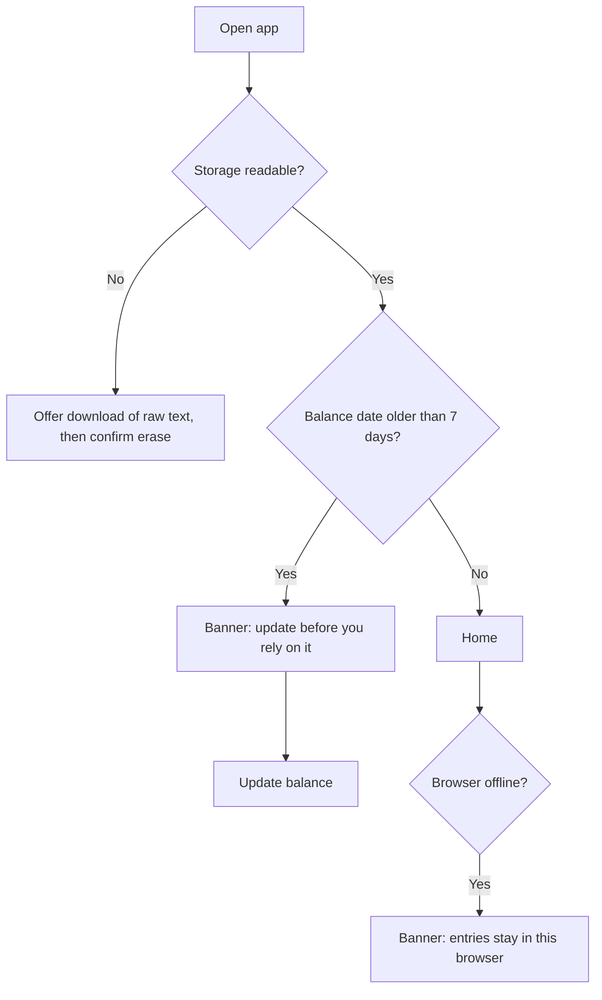

# User flows

Primary path first. Alternate and error paths are included where a wrong turn would change the estimate or the person’s trust.

## 1. Primary: can I afford this?

**Start:** A plan with a balance. Sample data is an allowed start for a demo, if the banner is visible.

**End:** The person can say whether the purchase stays a scenario or is now part of the plan, and the home number matches that choice.

**Covers:** FR-03, FR-04, FR-07, and the core PRD flow steps 3–6.

## 2. First estimate without a bank

**Covers:** FR-01, FR-02, onboarding acceptance, empty state.

## 3. Edit or delete

**Covers:** FR-05. The risk note about edit previews is the preview on the form.

## 4. Low-balance alert

**Covers:** FR-06. Background scheduling is an explicit non-behavior.

## 5. Stale, unreadable, offline

Past occurrences are not rolled forward onto a stale balance. The estimate still starts on the saved date so the math can be inspected, and the banner says spending since that date is missing.

## 6. Export and delete

From Settings, download writes a JSON file on the device. Delete asks a second time. Cancel is the first button in the dialog. Escape closes the dialog. After delete, the explainer returns and storage no longer has the record.

## Entry and exit for the primary screen

| Screen | Enter from | Primary exit |
| --- | --- | --- |
| Home | Open app, save balance, save item | Explanation, what-if, timeline, add item |
| Explanation | Home “See the calculation” | Back via Home in the bar |
| What-if | Home “Try a purchase” | Discard, or add to plan then item detail |
