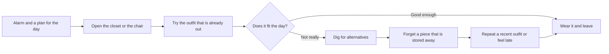
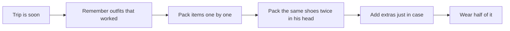

# Current-state journey — Rewear

**Status:** Hypothetical current state, before Rewear. Built so the opportunity areas are explicit. Not based on interviews. Do not present the emotions as measured.

Persona lens: Maya’s morning, with a side path for Sam’s packing night. Both are proto-personas.

## Maya, getting dressed for work

| Stage | What she is trying to do | Hypothesis pain | Opportunity Rewear takes | What we will not do |
| --- | --- | --- | --- | --- |
| Notice the day | Match clothes to work, weather, and time | The plan is in her head, not next to the clothes | Occasion and weather preference on the outfit | Sync her calendar or read her location |
| Look | See options, not only the pile on the chair | Stored pieces are invisible | Searchable grid with color and category as text | Require a photo before the item exists |
| Combine | Make a top and a bottom agree | Combinations are not saved, so she redoes them | Save the outfit, or read a suggestion’s reasons | Hide the reason inside a model |
| Commit | Leave without another loop | Recently worn outfits win because they are visible | “Mark worn” makes recency explicit. It does not ban a repeat. | Shame a repeat |
| Afterwards | Maybe wonder if a purchase was necessary | She cannot see overlap with what she owns | The wardrobe is there while she is still at home | Push a product to buy |

## Sam, packing the night before

| Stage | Hypothesis pain | Opportunity |
| --- | --- | --- |
| Remember outfits | Ideas are scattered | Saved outfits with occasion and weather |
| Translate outfits into things in a bag | Easy to double-count or forget a layer | One line per item, “In Office and Dinner” |
| Check the bag | A note does not tick itself against the outfit | Checklist persisted on the trip |
| Judge the trip later | He does not know if he overpacked | **Not built.** A “did you wear this?” prompt would be a later study, easy to make naggy. |

## Emotional hypothesis

The feeling to design for is **relief at seeing a finite set**, not excitement at a new identity. If the interface feels like a magazine, it has drifted. If it feels like a scold, it has failed the PRD.

## Opportunity areas carried into IA

1. First screen offers a sample wardrobe so the outfit job is visible before the cataloguing job.
2. Add item is short, and the photo can fail without ending the task.
3. Outfit and suggestion are both one tap from the outfits tab.
4. Trip creation is disabled until an outfit exists, with the reason written next to the button.
5. Destructive actions name the outfits they will change.
