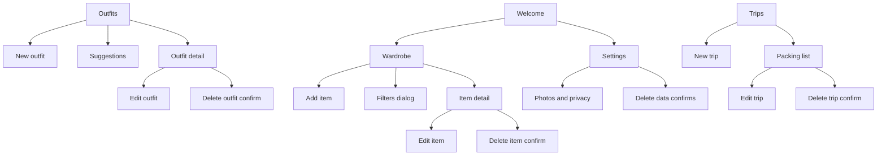
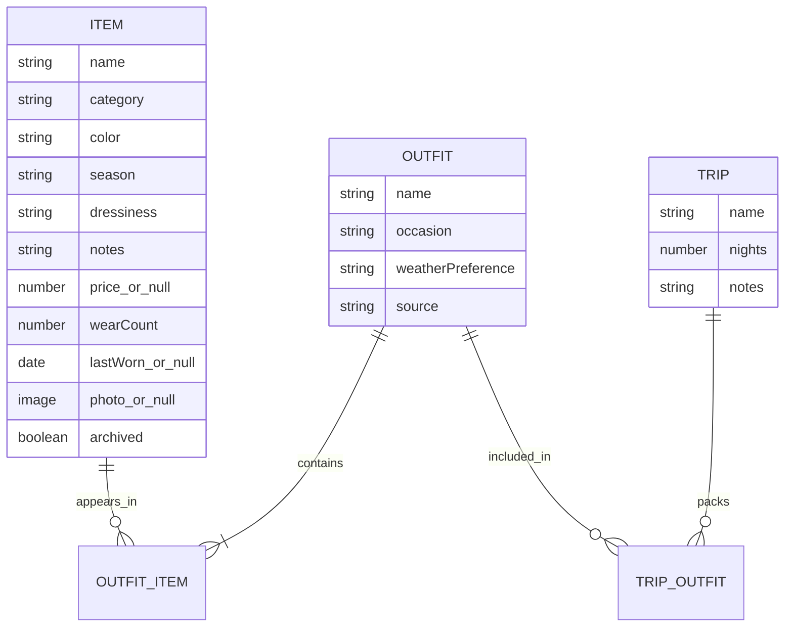

# Sitemap — Rewear

Mobile-first. Four destinations after the introduction. Settings is the “You” tab so privacy controls are not buried, and it is also reachable before onboarding.

## Navigation

| Tab | Contains | Not in this tab |
| --- | --- | --- |
| Wardrobe | Search, category chips, filters, grid, add item | Outfits |
| Outfits | Saved outfits, new outfit, suggestions | The trip checklist |
| Trips | Trip list and packing lists | A free-form item pack that ignores outfits |
| You | Text size, currency symbol, colors to skip, photo privacy, delete, sample reset, about | A profile photo or a social graph |

The introduction has no tab bar. Settings is linked from it so someone can read the storage explanation before they add anything.

## URL map in the prototype

| Hash | Screen |
| --- | --- |
| `#/welcome` | Introduction |
| `#/wardrobe` | Wardrobe |
| `#/items/new` | Add item |
| `#/items/:id` | Item detail |
| `#/items/:id/edit` | Edit item |
| `#/outfits` | Saved outfits |
| `#/outfits/new` | Outfit builder |
| `#/outfits/:id` | Outfit detail |
| `#/outfits/:id/edit` | Edit outfit |
| `#/suggest` | Suggestions |
| `#/trips` | Trips |
| `#/trips/new` | New trip |
| `#/trips/:id` | Packing list |
| `#/trips/:id/edit` | Edit trip |
| `#/settings` | Settings |

Unknown hashes show a toast: “That page is not in the prototype.”

## Object model

Packing lines are not stored as their own records. They are derived from the outfits on the trip, so a deleted item disappears from the list and a shared item cannot be double-counted. Packed checkboxes are stored as item ids on the trip.

## Labels that must stay stable

Wardrobe, Outfits, Trips, You, Add item, Save item, New outfit, Save outfit, Show suggestions, Why this was suggested, New trip, Build packing list, Mark worn today, Archive, Delete item, Delete photo.
