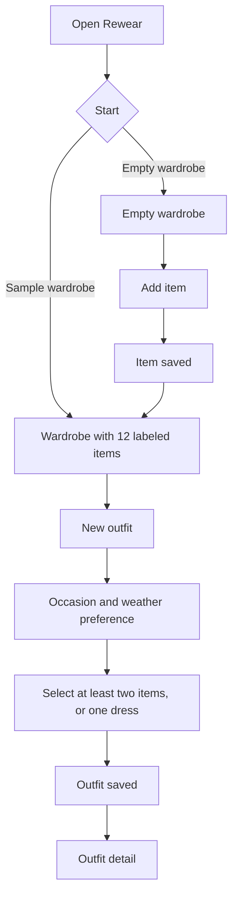
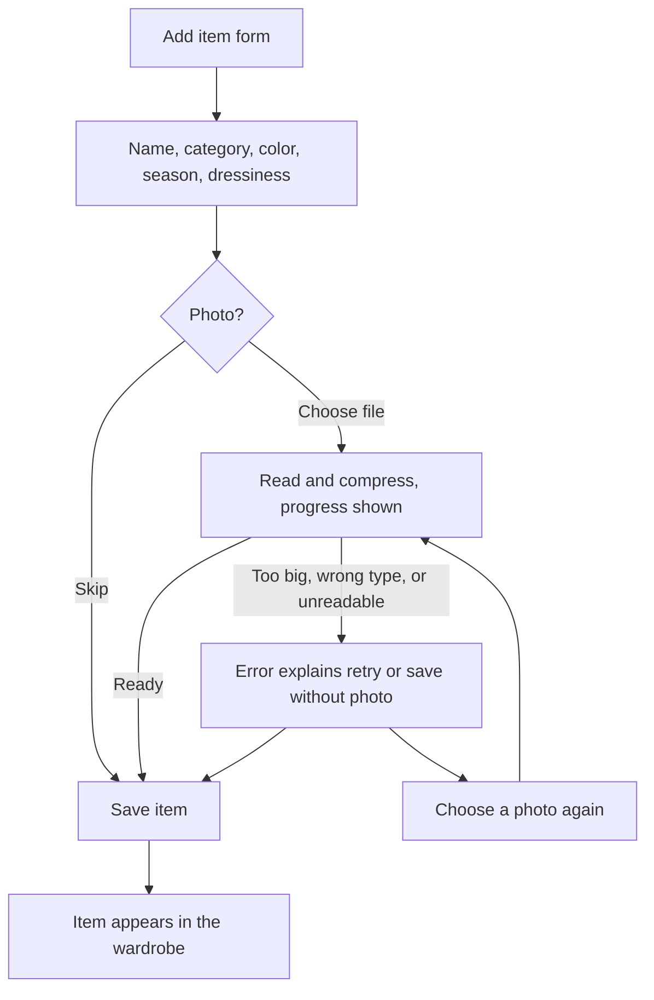
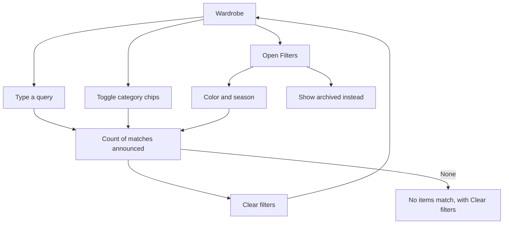
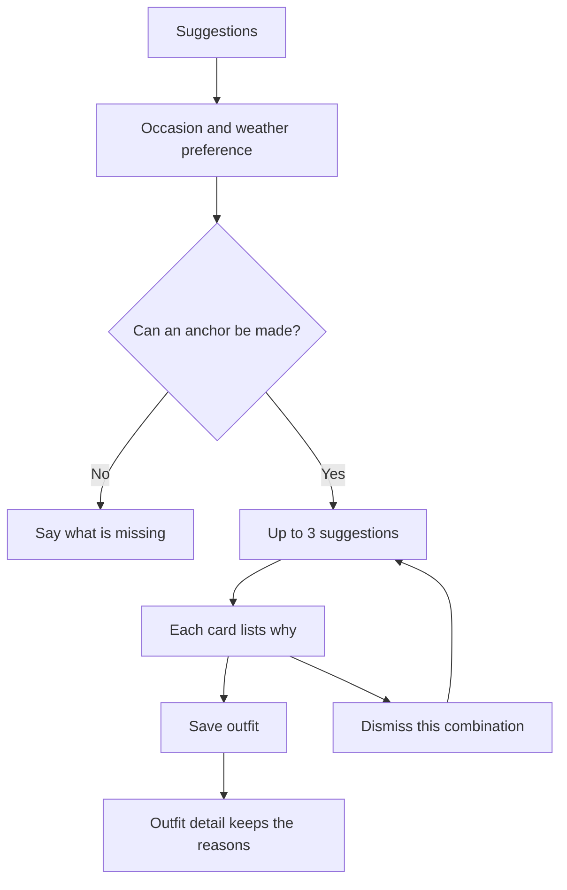
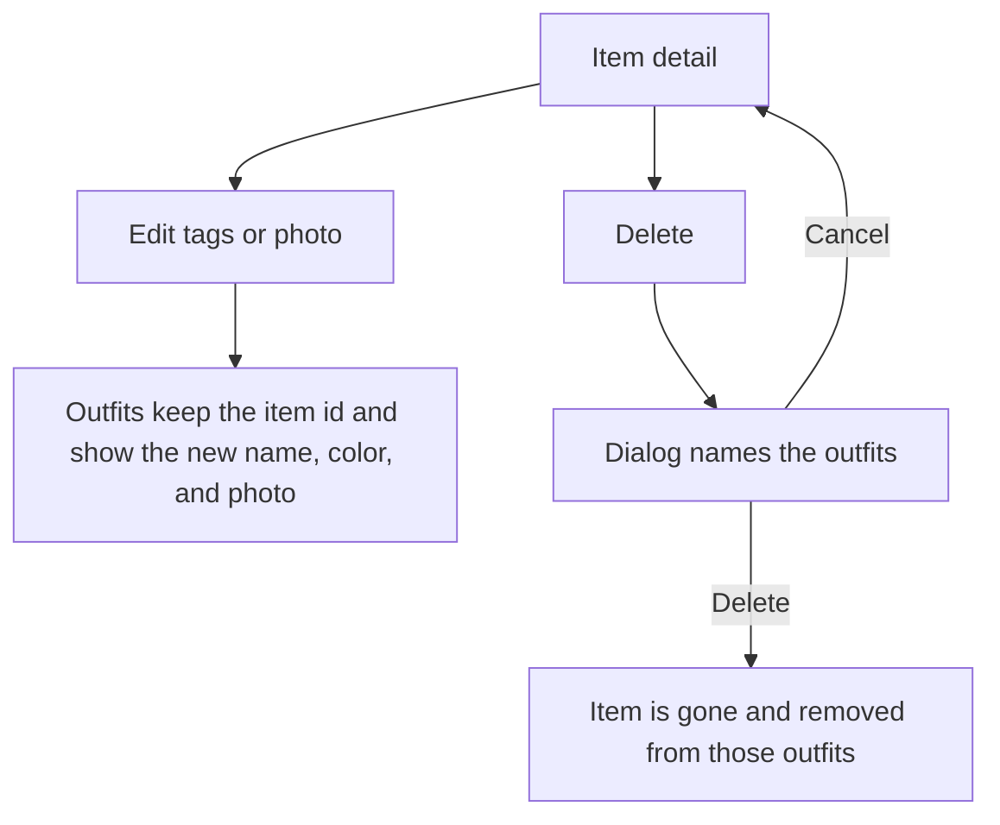
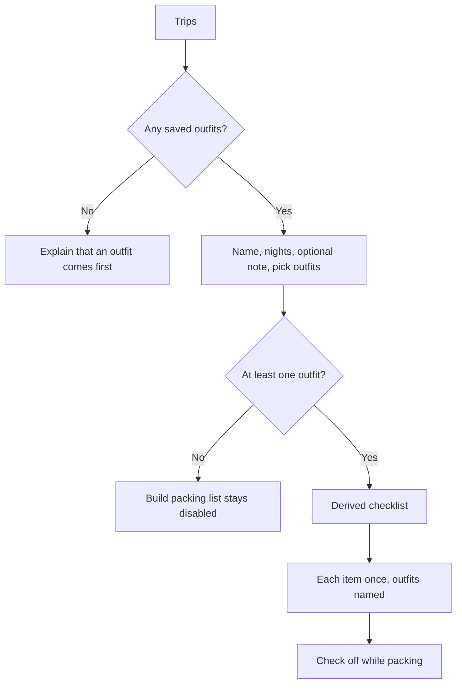

# User flows — Rewear

The primary flow is the PRD’s core path. Alternate and failure paths are part of the same flow, not appendices that were skipped.

## 1. Primary: from nothing to a saved outfit

**Done when:** the outfit detail shows the occasion, the weather preference, and the current items.

**Sample branch:** the reviewer or participant can reach an outfit without adding five items. The activation metric still requires a separate add task. Do not count the sample load as five items added.

## 2. Add item, including photo failure

Manual entry is on the same form. It is not a second product behind an “advanced” link.

## 3. Find an item

Logic: category, color, and season groups combine with AND. Values inside one group combine with OR. Archived view replaces the active grid rather than mixing them. Search matches name, notes, category, color, season, and dressiness.

## 4. Suggestion, then save or dismiss

A combination that is already saved, or already dismissed, is not offered again until the wardrobe changes enough to make a different set.

## 5. Edit or delete an item that is in outfits

Archive is the softer path: the item leaves the active grid and the outfit builder, and remains inside outfits already saved, with an Archived label on the outfit.

## 6. Trip packing

Nights are a label from 1 to 21. They do not multiply the items. A four-night trip with two outfits does not mean “pack the shirt four times.”

## 7. Offline and storage

The prototype is local. If the browser is offline after load, a banner says the wardrobe still works. If storage throws, a toast says the latest change may disappear on refresh. There is no queued sync, because there is no server.

## Keyboard and back paths

- Every form has Cancel returning to the parent.
- Delete dialogs have Cancel and a named destructive button. Escape closes the dialog.
- Filters dialog has Show results and Clear filters. Escape closes it.
- Focus moves to the screen title on navigation.
