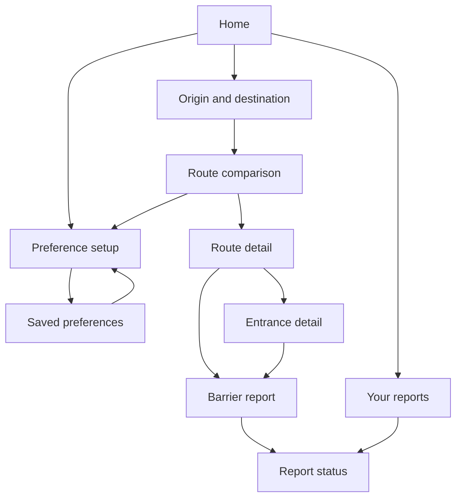

# Sitemap

AccessPath is a short tree. The primary nav is Home, Plan, Preferences, and Reports. Comparison, detail, entrances, and the report form sit under Plan.

## Labels used in the prototype

| Nav label | Screen | Notes |
| --- | --- | --- |
| Home | Plan a route around your access needs | Recent routes and the preference summary. |
| Plan | Where are you going? then Compare routes | Plan stays current through comparison. |
| Preferences | How should this route treat access? and Saved preferences | One nav item covers setup and the saved view. |
| Reports | Your reports, the form, and status | |

## Objects

- Preference set: preset, avoid stairs, curb ramps, max grade.
- Place and entrance.
- Trip: origin, destination.
- Route and segment.
- Evidence on an attribute: confirmed, community-reported, unknown.
- Barrier report: pending or withdrawn for the traveler. Verified exists on sample data so the contrast is visible.
- Service notice: source, summary, updated time. Sample only.

## What is intentionally absent

- Account, payment, social feed, turn-by-turn, multi-city switcher, and a public moderation queue.
- A layer browser for every accessibility attribute in the city. The MVP is a trip, not a map to explore.

## Deep links for review

The prototype accepts `?shot=` so a reviewer can open a state directly: `home`, `preferences`, `trip`, `results`, `map`, `detail`, `place`, `report`, `status`, `saved`, `nomatch`, `outside`, `error`, `offline`, `location`, `loading`. Shot mode hides the prototype control panel. Opening `status` or `saved` writes sample data into that browser's local storage.
