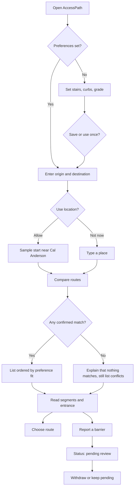

# User flows

The primary flow is the PRD sequence. Alternate paths are part of the prototype, not slides.

## Primary flow

## Preference flow — FR-01

1. Choose Step-free, Gentle grades, Stroller or luggage, or Custom.
2. Adjust the three settings. Any edit that no longer matches a preset becomes Custom. Choosing Custom keeps the current settings rather than clearing them.
3. Save preferences, or use them for this trip only.
4. Return to the trip or the results. Results are recalculated.
5. If every route conflicts or is incomplete, the headline says no route matches on confirmed data. The routes remain.

Gentle grades does not turn stairs on. That is deliberate: the name is about slope. The stair checkbox is on the same screen.

## Comparison flow — FR-02, FR-03, FR-04

1. The default sort is preference fit: matches, then unknowns, then conflicts. Time breaks ties.
2. Shortest sort reorders and adds a sentence telling the person to read the access status.
3. List and Map are tabs. The text list is always in the page. On a narrow screen the schematic is hidden in List and shown in Map. From 960px wide, the schematic stays visible.
4. Mark on the map thickens that route's lines. It does not choose the route.
5. View details opens segments. Each segment shows stairs, grade, curb ramp, and surface with an evidence chip.
6. Choose this route writes a recent trip on the device and says turn-by-turn guidance will not start. Undo removes it.

## Report flow — FR-05

1. Start from a segment or an entrance. The place is filled in.
2. Category and a description of at least a short sentence are required.
3. Submit stores the report in the browser with status Pending review and a timestamp.
4. The status screen says it is not verified and will not be shown to others as a confirmed fact.
5. Withdraw changes the status to Withdrawn. The row stays.
6. Offline submit is refused. The draft stays on the form.

## Alternate and error paths

| Path | Result |
| --- | --- |
| Same origin and destination | Inline error. Compare does not run. |
| Destination outside the sample, such as Bainbridge ferry terminal | "No pilot data for this trip." No line. |
| In-pilot pair with no sample route, such as the library to Volunteer Park | "No compared route for this pair." |
| Volunteer Park with step-free settings | The only route conflicts. Headline says nothing matches. |
| Routing error | No cards. Try again. |
| Offline | No guessed route. Saved preferences still open. |
| Location denied | "Location stays off. Type a start place." |
| Delete preferences | Confirm, then the saved screen is empty. |

## Evidence rules inside the flow

- Confirmed value within settings: counts toward a match.
- Unknown on a selected setting: the route cannot match.
- Community report of a problem on a selected setting: conflict, labeled not verified.
- Community report that the way is clear: still not confirmed.
- Surface unknown: disclosed, and it does not block a match, because surface is not a setting.
- Verified elevator outage on the route: conflict, with source and time.
