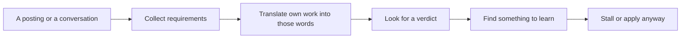

# Current-state journey map

**Status:** Hypothesis of the current state, before SkillBridge. Not based on interviews.
**Date:** 22 October 2026

The map describes a career changer looking at one new title over a few evenings. Opportunity areas are design bets. They are not observed needs.

| Stage | What they might do | Pain hypothesis | Opportunity area | What SkillBridge does with it |
| --- | --- | --- | --- | --- |
| Trigger | Opens a posting or hears a title from a friend. | The title does not say which skills matter. | Show one role in plain language, with a source. | Goal list and role profile. |
| Collect | Copies bullets into a note, or uploads a resume to a matcher. | The list mixes tools, traits, and keywords. | Separate skills with definitions. Mark core and supporting. | Editable profile. |
| Translate | Rewrites bullets so the words match. | They cannot tell "I have done this" from "the keyword appears." | Ask for proficiency and confidence in their own words. | Skill form. Optional paste with review. |
| Judge | Reads a match rate or asks someone if they are ready. | The number feels like a hiring chance. | Answer in sentences. Say there is no score. | Comparison narrative and definitions. |
| Plan | Opens a long roadmap or a course search. | The plan is larger than the week. | Cap the first plan at three actions with a first step. | Roadmap. |
| Stall | Saves the tab and does not return. | Nothing is small enough to finish, and nothing is theirs to edit. | Let them mark done, undo, and delete. | Progress and Settings. |

## Emotion hypothesis

The risky point is Judge. A wall of red gaps would confirm the fear that the product is grading them. The empty state and the comparison order are aimed at that point. Whether it works is a usability question in scenario U3.

## Future-state slice the prototype demonstrates

Choose a role → confirm skills → read the comparison → save three actions → mark one done and undo it.

That slice is the prototype journey in `07-prototype/prototype-flow.md`. It is not evidence that people want this order. Interviews can show that the real first step is the posting, in which case the future state should start there.
