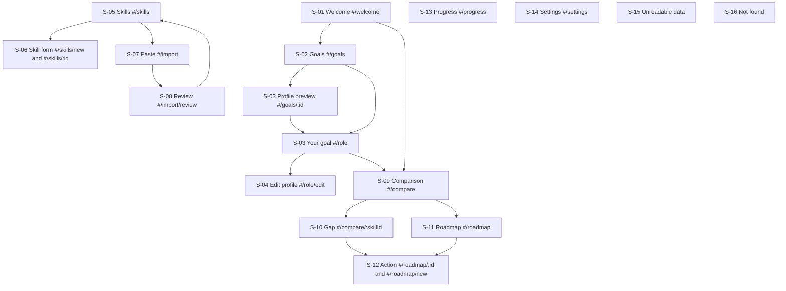

# Sitemap

**Product:** SkillBridge
**Navigation:** Hash routes in a single page. Five primary items, plus Settings and the wordmark home.
**Date:** 22 October 2026

## Primary navigation

| Label | Route | Current when |
| --- | --- | --- |
| Goal | `#/goals` | Goals, preview, role, edit |
| Skills | `#/skills` | Skills, skill form, import, review |
| Comparison | `#/compare` | Comparison, gap |
| Roadmap | `#/roadmap` | Roadmap, action |
| Progress | `#/progress` | Progress |

Settings is a text link in the header, not a sixth tab. Welcome has no tab selected. The header shows the display name when one is saved.

## Continue rule

`continueHash` sends a returning person to the next unfinished step:

- No goal → `#/goals`
- Goal and no skills → `#/skills`
- Goal, skills, and no actions for that goal → `#/compare`
- Actions already saved for the goal → `#/roadmap`

## Not in the map

There is no account, no public profile, no employer area, and no resource catalog page. Example links open in a new tab from the action.

A diagram of the same primary path is in `assets/diagrams/primary-flow.svg`.
