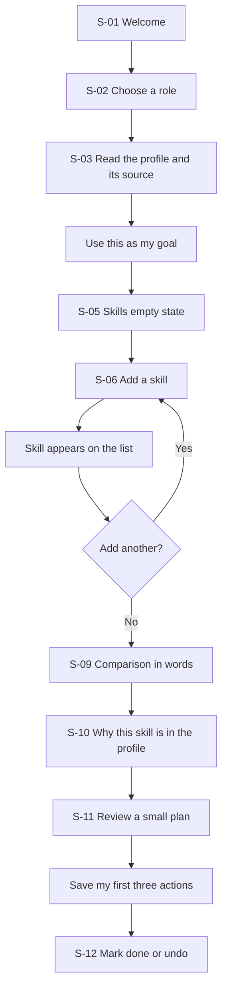

# User flows

**Date:** 22 October 2026
**Primary path:** Welcome → goal → skills → comparison → three actions → mark done.

## Flow A — First comparison without a resume

This is the release check: a person can define a goal and skills without importing a resume.

**Alternate:** From S-02, "Use this role" skips the preview. The source is still on S-03 later.

**Alternate:** "Describe a role that is not listed" creates a custom profile with no requirements. Comparison stays empty until they add requirements on S-04.

## Flow B — Maya's sample

Welcome → Explore with Maya's sample → S-09 with the fictional shift-lead inventory against Product operations associate.

If the browser already has skills, actions, or a custom role, a confirm dialog explains that the sample replaces that work. Cancel leaves the data.

## Flow C — Resume paste

S-05 → S-07 paste or "Use the practice resume" → S-08 check suggestions → save checked skills only → S-05.

Discard asks for confirmation when the textarea is not empty. The paste is not written to localStorage.

**Error:** Empty paste, or more than 12,000 characters, stays on S-07 with a message. No phrases found stays on S-07 and tells them to add skills directly.

## Flow D — Edit the profile

S-03 → S-04 Hide, Restore, or Add a skill with a why of at least 8 characters. Existing actions are not deleted when a requirement is hidden.

## Flow E — Progress and undo

S-12 status buttons: Not started, Doing, or Done. A toast names the new status and offers Undo. S-13 shows the done count, a meter, the status word, and a link to the action. It also holds one reflection note of at most 2,000 characters.

## Flow F — Delete and unreadable data

Settings → Delete saved data → confirm → welcome with an empty profile.

If saved JSON cannot be parsed or fails validation, S-15 is the only screen. The bad value stays until "Delete the unreadable data and start over." The app does not overwrite it on refresh.

## Flow G — Not found

Any other hash → S-16. Saved data is unchanged. Link returns to welcome.

## Error and empty paths

| Situation | What the person sees | Next action |
| --- | --- | --- |
| Comparison with no skills | Empty state. No gap wall. | Add a skill. |
| Comparison with no role | Prompt to choose a role. | Goals. |
| Custom role with no requirements | Empty profile. | Edit the profile. |
| Skill form with no skill chosen | "Choose a skill." Values stay. | Pick one. |
| Duplicate skill | Error. The existing skill remains. | Edit that skill. |
| Action title empty or too short | Field error. | Rewrite. |
| Save blocked by the browser | Message that the change is on screen and may disappear on refresh. | Settings copy, if save works later. |
| Offline after load | The static page and local data still work. New example links need a network. | No dedicated offline screen. |
