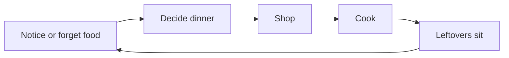

# Current-state journey map

**Status:** Illustrative hypothesis. It is a map of the problem the PRD describes, for design discussion. It is not a map of observed behavior. No participant IDs, quotes, or timings.

## Actor

Hypothesis persona A, on a weeknight, shopping tomorrow. Persona B is the same path with a shorter pantry and no second shopper.

## Stages

| Stage | What we assume they do | Pain hypothesis | Opportunity area | What we will not claim |
| --- | --- | --- | --- | --- |
| Notice or forget | Opens the fridge while thinking of a dish. Some items are unseen in the freezer or cupboard. | Food is forgotten because the decision starts from the dish. | Start the next session from items with dates they entered. | That people want a full inventory. |
| Decide dinner | Searches a recipe or repeats a known meal. | The recipe’s list ignores what is already paid for. | Show match and gap in the same words: Have, Short, Check, Missing. | That a large catalog is the value. |
| Shop | Buys the recipe list, or shops from memory. | Duplicates. Uncertainty becomes another purchase. | Subtract only confirmed amounts. Leave a Check line when the unit or quantity is unknown. | That hiding “maybe” items is helpful. |
| Cook | Uses some of an item. The rest goes back. | The list, if any, is now wrong, so they stop trusting it. | Propose the amount used, let them edit, then undo. | That automatic detection is required. |
| Leftovers sit | Package date may or may not be read. | Ambiguous dates. Fear of being told the food is bad, or being told it is fine. | Store the date type they choose. Refuse a verdict. Link out to FSIS and FoodKeeper. | A shelf-life table. |

## Emotional hypothesis

Unease at the shop (“do I already have chickpeas?”) and avoidance afterward (“I will not open that container”). The product should lower the first without pretending to settle the second.

## Opportunity to prototype now

One loop: see Use soon, open one recipe, review the gap, mark cooked. That loop is what the browser prototype implements. It tests the opportunity column. It does not test whether the pain column is true.

## After real research

Replace each pain cell with evidence IDs from `research-findings.md`. Delete any stage nobody mentions. If “shop” and “decide” are done by different people, split the map before adding household features.
