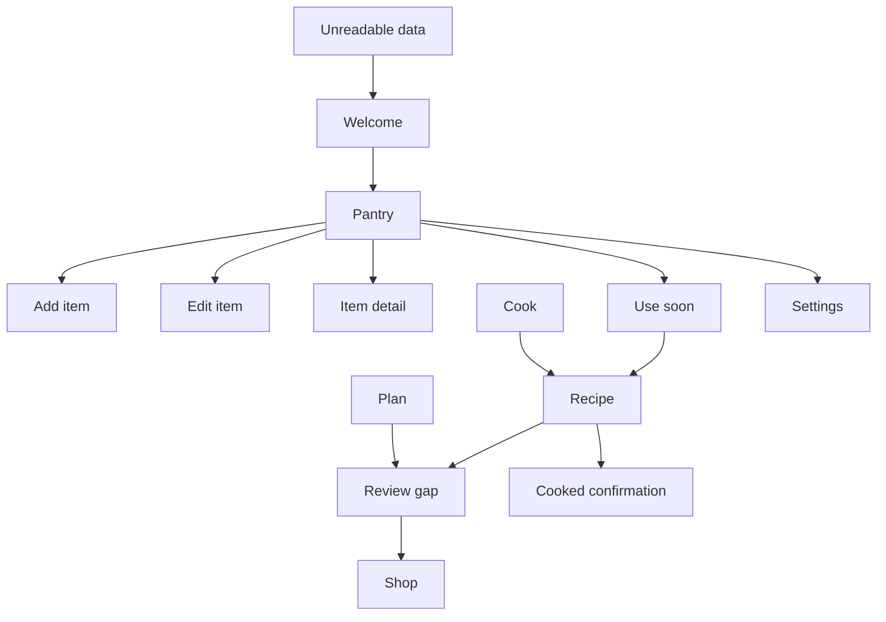

# Sitemap

FreshLoop is one kitchen on this device. Primary navigation is Pantry, Cook, Shop, and Plan. Settings sits in the header, not in the bottom bar, because it is not part of the dinner decision.

Below 960px the four destinations are a bottom bar. From 960px they become a side column and the bottom bar hides.

## Routes

| Hash | Screen | Primary nav highlight |
| --- | --- | --- |
| `#/welcome` | Welcome | None. No bar. |
| `#/pantry` | Pantry | Pantry |
| `#/use-soon` | Use soon | Pantry |
| `#/add` | Add item | Pantry |
| `#/edit/:id` | Edit item | Pantry |
| `#/item/:id` | Item detail | Pantry |
| `#/cook` | Cook | Cook |
| `#/recipe/:id` | Recipe | Cook |
| `#/review` | Review the gap | Shop |
| `#/shop` | Shopping list | Shop |
| `#/plan` | Four-day plan | Plan |
| `#/cooked/:id` | Cooked confirmation | Cook |
| `#/settings` | Settings | None |
| `#/recovery` | Unreadable saved data | None |
| anything else | Missing page, link back to Pantry | None |

## What is deliberately not a destination

- A recipe feed on its own tab. Cook is a list filtered by the pantry, not a browse home.
- A safety or “expired” bin. Date passed is a label on the item, beside Use soon.
- Household members, store checkout, receipt inbox, and camera capture. Those jobs are out of scope or explicitly unavailable.
- A separate Reminders screen. The control lives in Settings. The in-app notice, when reminders are allowed, appears on Pantry while the page is open.

## Labels

Use soon, Date passed, Opened, No date, Have, Short, Check, Missing, Staple, Optional. Do not rename these in later screens. “Expired,” “unsafe,” and “throw it away” are not labels.
