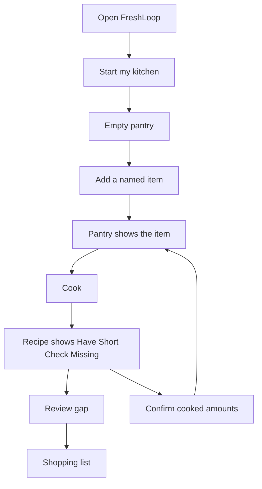
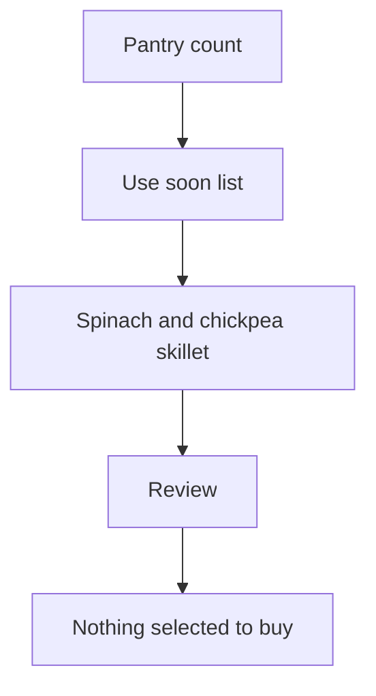

# User flows

The happy path is the PRD core flow. Alternate paths are specified because a silent shortcut would invent a quantity or a safety verdict.

## 1. Primary: from an empty start to a cooked update

Entry: first visit, no `freshloop.v1` data. Exit: the item they added is still in the pantry, and a cooked recipe has subtracted only amounts they confirmed.

## 2. Demo path

`?demo=1` seeds the sample kitchen only when `freshloop.v1` is absent. It does not overwrite an existing kitchen. If the hash is empty or `#/welcome`, it opens Pantry. The banner says the items are fictional.

Sample, on a clock of 22 October 2026 with a 3-day window: spinach, chicken, milk, and bread are Use soon. Plain yogurt is Date passed. Ginger is Opened. Lemon has no date.

## 3. Use soon to a covered recipe

Staples stay off when the setting is on. Cumin is optional and missing, so it is left off unless the person includes it. This is the path the sample kitchen is built to show.

## 4. Unit mismatch stays on the list

Yogurt oat bowl asks for yogurt in grams. The sample yogurt is 1 piece. The row is Check. The review keeps yogurt on the list and says nothing was subtracted. The person can remove the line. The app does not convert a piece into grams.

## 5. Two dinners, one pantry

Plan two servings of the skillet on day one and lemon chicken on day two. Review sums the shared ingredients and subtracts the pantry once. In the sample, spinach is covered. Lemon and garlic are short because both dinners need them and the pantry has one of each. Commit writes those lines to Shop.

## 6. Duplicate name

Quick add “Spinach” while spinach is already in the fridge. A dialog names the existing item. When the units match, the person can add to the existing item or save a separate item. Different units do not merge. Cancel leaves the pantry unchanged. The same name in another location is noted, not blocked.

## 7. Barcode guess

On Add, a code of `000000111111` fills Oat milk, 1 L, fridge. The copy says it is not in the pantry until Save. Leaving the screen without saving does not add it. Any other code says there is no sample product and nothing was added. “Scan a receipt” opens a dialog that says receipt scanning is not connected and offers “Add items myself.” It does not open a camera or pretend to read a receipt.

## 8. Reminders

Settings shows reminders off. Allow is a simulated permission. Deny leaves reminders off and returns to the kitchen. The lead window (1, 2, 3, or 7 days, default 3) still defines Use soon when reminders are off. The prototype cannot notify after the page closes. That sentence is on the permission dialog.

## 9. Diet filter

Vegan hides recipes with a listed meat, dairy, or egg flag, including the optional egg on pea and rice skillet. The cook page says the filter is not an allergen or medical judgment. Clearing filters shows the full sample catalog.

## 10. Unreadable data and offline

If `freshloop.v1` is not valid JSON, Recovery offers a download of the raw text and an erase. The app does not replace the text with an empty pantry. Offline shows a banner. The pantry and the sample recipes remain, because both are on the device.

## 11. Delete

Settings asks for confirmation before deleting the kitchen. The prototype keeps an undo snapshot for pantry updates, including a delete that the person undoes from the toast. Export downloads the JSON the app stored.

## Error and empty rules

| Situation | Behavior |
| --- | --- |
| Blank name | “Enter a name.” Nothing is saved. |
| Quantity zero | Rejected. Zero is not a stored amount. |
| Unit chosen and quantity blank | Rejected. The app will not assume an amount. |
| No items | Pantry explains that Cook needs at least one item, and offers add plus the sample kitchen. |
| No recipe id | Missing page, link to Cook. |
| No shopping lines selected | Review says nothing is selected to buy. Commit is not the way to invent lines. |
