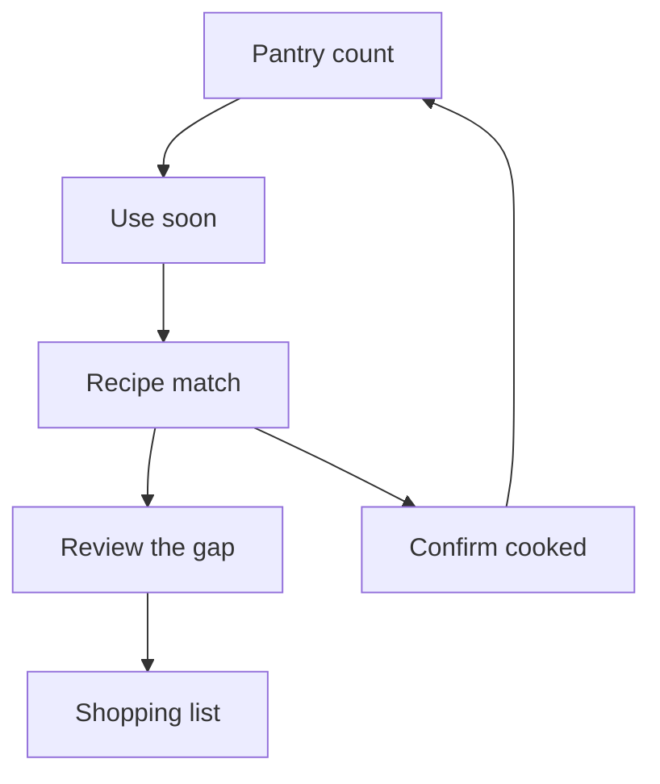

# FreshLoop

**Know what to cook before your groceries go to waste.**

| | |
| --- | --- |
| Role | End-to-end product design, UX writing, design system, and front-end prototype |
| Timeline | Proposed concept, not a staffed engagement |
| Status | Design and prototype complete for review. Validation planned. |
| Platform | Mobile-first web prototype |

## Executive summary

FreshLoop starts from the food already at home. The person logs what they have, sees which dates they entered are soon, and opens a recipe that shows what the pantry covers and what it does not. The shopping list subtracts an amount only when the units compare.

The case for that loop is a hypothesis in the PRD. No interviews and no usability sessions have been run. Competitor pages were read on 22 October 2026 and are cited in the analysis. The prototype is the argument: an inventory-first kitchen that refuses a safety verdict and refuses a silent quantity.

## Problem and why it matters

Households forget food in the fridge, freezer, and cupboards, then buy it again. Many meal tools start from a dish. The dish’s ingredient list does not know what is dated for tomorrow. The cost is duplicated groceries and food that never gets chosen.

The design bet is that the hard moment is the decision, not the catalog. If people will not log food, the bet fails. That is the first research question, and it is still open.

## Target users and evidence status

**Primary hypothesis:** people who plan meals and shop for a household.

**Secondary hypothesis:** students and budget-conscious cooks with a smaller pantry.

Both are proto-personas. They are labeled as hypotheses in `02-ux-research/personas.md`. There are no quotes.

## Research approach and findings status

The plan is six recent-behavior interviews, then five usability sessions. The interview guide avoids leading with the product. Findings are an empty log. Illustrative journey stages are marked as hypotheses. Nothing in the case study should be read as a user insight.

## Competitive landscape and opportunity

Reviewed pages for NoWaste, Samsung Food, SuperCook, and The Pantry, plus USDA FSIS dating guidance and FoodSafety.gov FoodKeeper. Kitche is treated as historical because its current app was not rechecked.

What those pages support, in short:

- NoWaste already offers inventory, capture, lists, recipes, and meal plans. Its homepage states a 3.29% waste rate. That is the company’s claim, not an independent result, and it is not evidence for FreshLoop.
- Samsung Food can flag shopping-list items the person might already have, and “Made it” can suggest removing ingredients on Food+.
- SuperCook states that it assumes salt, pepper, and water. The page reviewed does not describe a dated pantry. That is a limit of the page, not a claim that no SuperCook surface has dates.
- FoodKeeper is the right kind of product for storage times. FreshLoop links to it and does not copy those times into rules.

The opportunity is not “they have no barcode.” Several do. The opportunity is a decision that shows its arithmetic: a date type the person chose, a match word on every ingredient, and a shopping line that stays when the unit does not compare.

## Product strategy and prioritization

Must-have work is the loop: add, notice, match, review the gap, update the pantry. Should-have work in the prototype is units, a four-day plan, batch move and remove, and diet filters with a limitation. Barcode entry is two fictional codes and a confirm step. Receipt scanning is an unavailable dialog.

Out of the MVP: shared editing, retailer checkout, image recognition, automatic purchase, medical advice, and any shelf-life score.

Batch quantity edit is a partial Should. Partial consume exists on the item. The batch action removes the whole selected item.

## Information architecture and key user flow

Four destinations: Pantry, Cook, Shop, Plan. Settings is in the header. Use soon is part of Pantry, because it is the same decision, not a second product.

The sample kitchen makes the rules visible. On the test date, four items are Use soon and yogurt is Date passed. The spinach skillet is covered. Yogurt in the oat bowl is Check, because a piece is not grams. Two dinners share the lemon and the garlic, so the list asks for one more of each and does not ask for spinach.

## Early wireframes and rationale

Sixteen grayscale SVGs, 1040×980, with a 390×844 phone and an annotation column. They were generated, not drawn in Figma. Figma was not available.

The frames put the count above the storage list, put a word on every status, and give Review its own screen. A wireframe that jumped from recipe to a finished list would have hidden the product.

## Visual direction and design system

Warm paper, forest green for the primary action, citrus for Use soon, clay for Date passed. Georgia for the sentence, Segoe UI for the UI. Green is not used as “fresh” or “safe,” so the action color and the status colors do not argue.

Tokens live in `prototype/styles.css`. Contrast pairs used for text are asserted at or above 4.5:1 in the unit tests. The focus color is asserted at or above 3:1 against paper.

## Final screen walkthrough

1. Welcome states the UVP once and the safety limit immediately.
2. Pantry leads with the Use soon count and a separate Date passed line.
3. Use soon shows Opened as its own status.
4. Cook ranks the sample catalog from the pantry and states that diet filters are not a medical judgment.
5. The recipe lists Have, Short, Check, Missing, Staple, or Optional, then the steps.
6. Review shows what would be bought and what was left off.
7. Cooked asks “Update the pantry?” and can undo.
8. Settings holds the lead window, staples, export, and delete.
9. Recovery downloads unreadable saved text instead of replacing it with an empty kitchen.

Screenshots of the prototype are in `assets/screenshots/`. They are sample data.

## Key interaction

The interaction that carries the UVP is the review, not the recipe card. A covered ingredient is left off and named. A mismatched unit stays, with the reason. A plan subtracts the pantry once. Confirming “I cooked this” proposes amounts, prefers the sooner dated item, and keeps an undo snapshot.

## Accessibility, edge cases, and trust

The interface aims at WCAG 2.2 AA: skip link, labels, dialog focus, visible focus, status words, reduced motion. A screen-reader session has not been run.

Trust choices:

- No keep-or-discard verdict. Phrases such as “safe to eat” and “throw it away” fail a unit test if they appear in product copy or date explanations.
- Links to FSIS food-product dating and FoodKeeper. The app does not apply those storage times.
- Diet filters include optional ingredients and say they do not check cross-contact.
- Reminders are off until a simulated permission. Denial does not block the app. The prototype cannot notify after the tab closes.
- Data stays in `freshloop.v1` on the device. Export and confirmed delete exist. Storage is not encrypted.

## Usability validation status and iterations

Validation is planned. The test plan has five tasks, a severity scale, and an empty findings template. An example row is marked as an example.

Build notes, such as stacking the pantry row so the name does not run into the quantity, are in the iteration log and are labeled as build notes. They are not user preferences.

## Success metrics and how they would be measured

North star candidate: self-reported discarded-food frequency, baseline and follow-up, in a later pilot.

Session targets from the PRD, still unmet because the test has not been run:

- 75% can add an item and find a relevant use-first recipe.
- 70% can create a shopping list that excludes ingredients already available, with a guard that a Check line is not silently subtracted.

Automated tests show that the prototype implements those rules on the sample data. They are not user evidence.

## Limitations, learnings, and next steps

**Learnings from the design, not from users:**

- Honesty needs a screen of its own. Match badges on a recipe are not enough if the list is written in the background.
- An opened-on date has to be a different object from a best-before date, or the home count becomes a verdict.
- A competitor having recipes and a shopping list is not a reason to skip the quantity rule. It is a reason to show the rule.

**Limits:**

- No participants.
- Sample recipes and sample barcodes only.
- One device, one kitchen.
- In-app reminders only.
- No Figma file.
- Regional date language is still an open PRD question.

**Next:**

1. Run the six interviews before treating the maintenance problem as real.
2. Run the five usability tasks. Stop early if people think the app certified the food.
3. Only then choose a licensed recipe source or a real barcode provider. Do not add either to make the prototype look finished.
