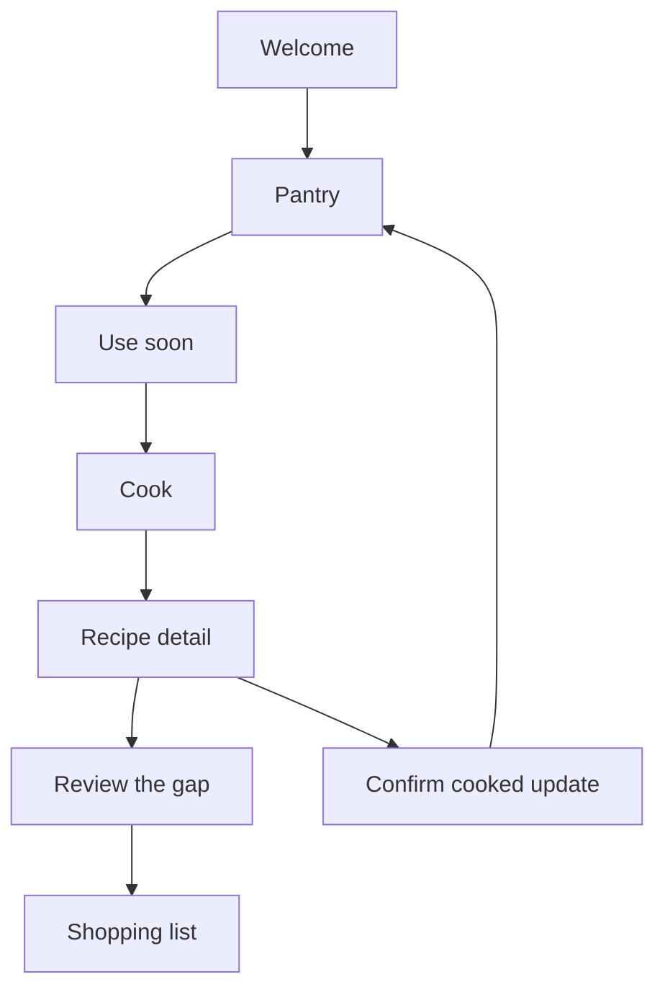

# Core flow

Inventory first. The person sees dates they entered, then a recipe, then a gap, then an update. Sample data in the prototype is fictional.

## Match words

| Word | Meaning in FreshLoop |
| --- | --- |
| Have | Pantry quantity covers the recipe amount in a comparable unit |
| Short | Same unit family, not enough |
| Check | Blank quantity, or units that do not convert |
| Missing | No matching name |
| Staple | Salt, pepper, or water, left off when the setting is on |
| Optional | Marked optional on the recipe, left off the list unless included |

Opened is a date status, not a match word. It means the person stored an opened-on date. It is not an expiry.
